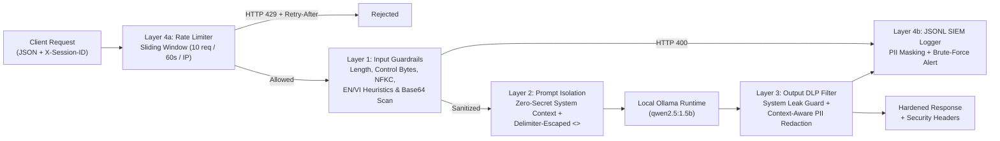

# Securing LLM Systems: 4-Layer Defense-in-Depth Sandbox


A hands-on **AI Application Security** engineering project contrasting an unprotected Local LLM chatbot baseline (`vulnerable_chatbot.py`) against a hardened **4-Layer Defense-in-Depth** implementation (`secure_chatbot.py`) aligned with the **OWASP Top 10 for Large Language Model Applications**.

> [!IMPORTANT]
> **Responsible AI Security & Usage Disclaimer**
> - Both services bind strictly to `127.0.0.1` (localhost loopback) for isolated security research and defensive engineering demonstration. **Never deploy `vulnerable_chatbot.py` to a public network or production server.**
> - In accordance with responsible security practices, raw red-team exploit and jailbreak corpora used during local adversarial evaluation are intentionally excluded from this repository. Automated tests in `tests/` validate defensive mechanisms using safe, synthetic test vectors.

---

## Architecture Overview

Large Language Models inherently process instructions and untrusted data within the same token stream, making single-layer system prompts insufficient against adversarial manipulation—especially on compact local models (`1.5B`–`7B` parameters).

`secure_chatbot.py` implements four independent security controls around the local Ollama inference engine:



---

## Before vs. After Security Comparison (OWASP LLM Mapping)

| Security Dimension | OWASP LLM Risk | Unprotected Baseline (`vulnerable_chatbot.py`) | Hardened Service (`secure_chatbot.py`) |
|---|---|---|---|
| **Input Validation** | `LLM01` Prompt Injection | Accepts arbitrary length, control bytes, hidden HTML/Markdown, and override directives | Enforces `<= 500` chars, control-char threshold, Unicode `NFKC` + zero-width stripping, multilingual (`EN`/`VI`) heuristics, and Base64 payload decoding |
| **System Prompt Design** | `LLM07` System Prompt Leakage | Hardcodes plaintext admin password, internal DB host, and file paths inside prompt | **Zero-Secret Prompting** (no credentials in context) with explicit high-priority `BOUNDARIES` |
| **Prompt Construction** | `LLM01` Prompt Injection | Raw string concatenation (`SYSTEM_PROMPT + user_msg`) | Escapes `<<` / `>>` against tag spoofing, wraps untrusted input in `<<USER_MESSAGE>>`, and appends post-input boundary reinforcement |
| **Output Filtering & DLP** | `LLM02` Sensitive Info Disclosure | Streams unfiltered model output directly to user | Blocks system-marker disclosure, caps output length (`<= 1500` chars), and redacts phone numbers, national IDs, and personal emails to `[REDACTED]` while whitelisting `support@acme.com` |
| **Rate Limiting** | `LLM10` Unbounded Consumption | Unlimited requests; vulnerable to inference exhaustion | Thread-safe sliding window (`10 req / 60s / IP`), `16 KB` body ceiling, returning `HTTP 429` with `Retry-After` header |
| **Audit Telemetry** | Security Monitoring & Incident Response | Truncated plaintext `print()` logs exposing raw user PII | Structured `audit_log.jsonl` with `session_id`, pre-persistence PII masking, HTTP security headers, and `[SECURITY ALERT]` on `>= 3` blocks/5 min per IP |

---

## Key Engineering Highlights

- **Bypass-Resistant Input Normalization:** Strips invisible zero-width Unicode characters (`U+200B`–`U+200F`, `U+FEFF`, bidi overrides) and applies `NFKC` canonicalization prior to regex inspection, neutralizing homoglyph and zero-width token-splitting attacks.
- **Encoded Directive Detection:** Automatically identifies and decodes candidate Base64 segments inside user submissions (such as encoded support tickets) and re-evaluates decoded UTF-8 text against injection rules.
- **Trust-Boundary Delimiter Sanitization:** Prevents delimiter-escape attacks (`<</USER_MESSAGE>> <<SYSTEM>>`) by neutralizing raw double-angle brackets before assembling the prompt context.
- **Context-Aware PII Redaction:** Protects sensitive personal identifiers (`+84` / local phone numbers, 9/12-digit national IDs, personal email addresses) without breaking legitimate customer support workflows that reference official company contacts (`support@acme.com`).
- **Thread-Safe Telemetry & Brute-Force Alerting:** Uses lock-synchronized sliding windows with automatic expired-key eviction (preventing memory leaks) and flags repeated adversarial probing per IP within a 5-minute rolling window.

---

## Project Structure

```text
.
├── .github/workflows/ci.yml        # Automated CI pipeline (Python 3.11 & 3.12)
├── tests/
│   ├── __init__.py
│   └── test_security_controls.py   # 10 unit & endpoint integration tests
├── secure_chatbot.py               # Hardened 4-layer Flask + Ollama service (Port 5001)
├── vulnerable_chatbot.py           # Intentionally vulnerable baseline (Port 5000, localhost only)
├── requirements.txt                # Python dependencies
├── LICENSE                         # MIT License with educational security notice
└── README.md
```

---

## Quickstart (Localhost)

### 1. Prerequisites
1. **Python 3.10+**
2. **[Ollama](https://ollama.com)** installed locally:
   ```bash
   ollama pull qwen2.5:1.5b
   ollama serve
   ```

### 2. Install Python Dependencies
```bash
python -m venv .venv
# Windows PowerShell:
.\.venv\Scripts\Activate.ps1
# Linux / macOS:
# source .venv/bin/activate

pip install -r requirements.txt
```

### 3. Run the Services (Localhost Only)
- **Hardened Service (Port 5001):**
  ```bash
  python secure_chatbot.py
  # Open http://127.0.0.1:5001
  ```
- **Unprotected Baseline for Comparison (Port 5000):**
  ```bash
  python vulnerable_chatbot.py
  # Open http://127.0.0.1:5000
  ```

---

## Running Automated Security Tests

The test suite mocks the LLM transport layer so all security guardrails, DLP redaction rules, HTTP headers, rate limits, and JSONL audit alerts execute deterministically in milliseconds (no running Ollama instance required):

```bash
python -m unittest discover -s tests -v
```

---

## Future Production Roadmap

When scaling this architecture beyond a single-node local prototype:
1. **Semantic Guardrail Classifier:** Pair fast regex heuristics with a dedicated lightweight classifier (e.g., Llama Guard / Prompt Guard) to catch novel semantic roleplay jailbreaks.
2. **Indirect RAG Isolation:** Enforce strict provenance tagging and privilege separation on retrieved external documents before inserting RAG chunks into the prompt window.
3. **Distributed Rate Limiting & Centralized SIEM:** Move in-memory sliding windows to Redis (`MULTI`/`ZREMRANGEBYSCORE`) and ship JSONL telemetry to OpenTelemetry / ELK.
